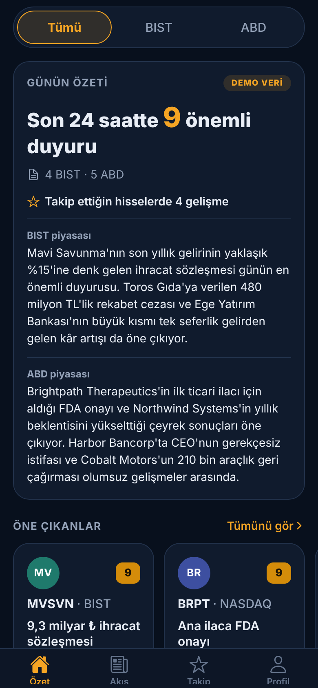
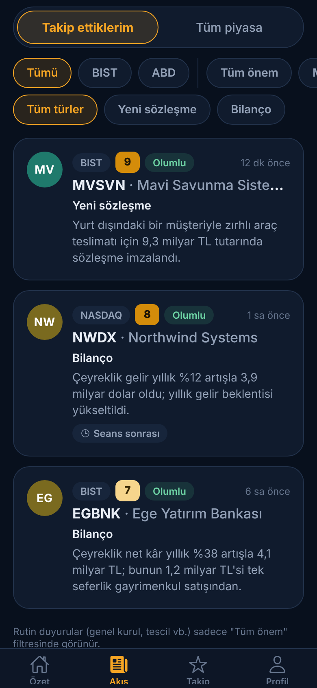
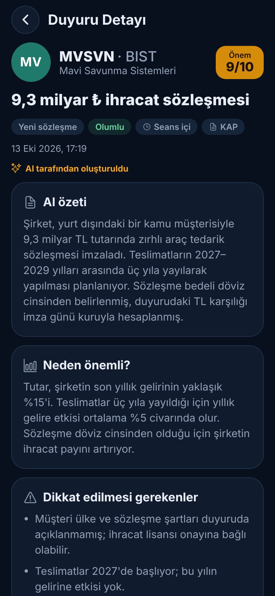
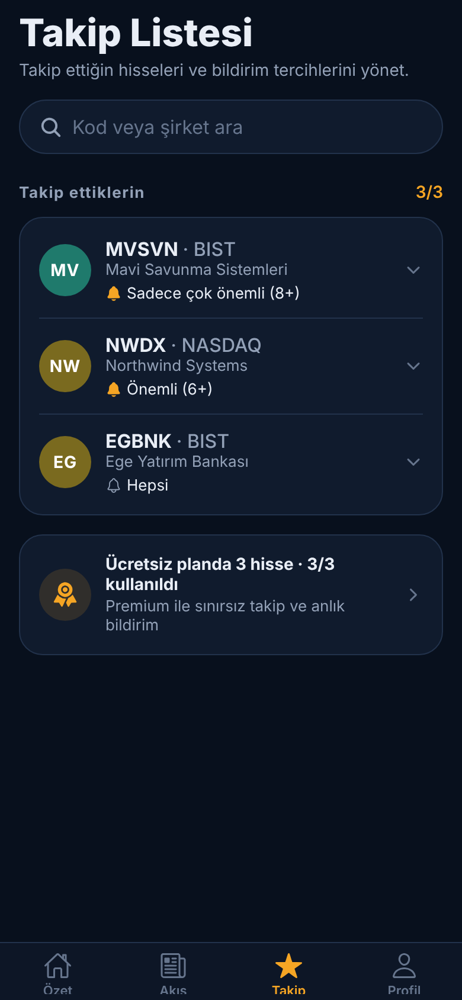

# Borsa Radar (iPhone uygulaması)

BIST ve ABD şirketlerinin resmi duyurularını (KAP, SEC EDGAR) yapay zekâ ile özetleyip kullanıcıya **sadece önemli olanları** gösteren iPhone uygulaması. Uygulama yatırım tavsiyesi vermez; "al/sat" veya fiyat tahmini sunmaz.

> **Şu anki durum:** Arayüz tamamen çalışıyor, ama içerik **demo veri**dir (şirketler ve haberler hayalidir). Gerçek veri ve AI analizi için backend henüz yazılmadı (aşağıda "Sonraki adımlar").

| Özet | Akış | Detay | Takip |
|---|---|---|---|
|  |  |  |  |

## Özellikler

- **Özet:** Son 24 saatteki önemli duyuru sayısı, takip ettiğin hisselerdeki gelişmeler, piyasa bazında günlük özet, öne çıkanlar
- **Akış:** Takip ettiklerim / Tüm piyasa; piyasa, minimum önem skoru ve olay türü filtreleri
- **Duyuru detayı:** AI özeti, "Neden önemli?", riskler, tutar ve yıllık gelire oranı (oran AI'ya değil koda hesaplatılır), orijinal duyuru bağlantısı
- **Takip listesi:** Hisse arama, hisse başına bildirim eşiği (8+ / 6+ / hepsi), ücretsiz planda 3 hisse sınırı
- **Profil:** Türkçe / İngilizce, koyu / açık tema, piyasa seçimi, Piyasa Radarı, sessiz saatler
- İlk açılışta karşılama ve yasal uyarı onayı
- Tüm ayarlar telefonda saklanır

## iPhone'da denemek (Mac gerekmez, ücretsiz)

1. Bilgisayarına (Windows veya Mac) **Node.js LTS** kur: https://nodejs.org
2. iPhone'una App Store'dan **Expo Go** uygulamasını indir.
3. Bu projeyi bilgisayarına indir ve terminalde şunları çalıştır:
   ```bash
   cd borsa-radar
   npm install
   npx expo start
   ```
4. Terminalde çıkan **QR kodunu iPhone kamerasıyla okut**. Uygulama Expo Go içinde açılır.
   - Bilgisayar ve telefon **aynı Wi-Fi ağında** olmalı. Bağlanmazsa `npx expo start --tunnel` dene.
   - Kodda değişiklik yaptığında telefon otomatik güncellenir.

## App Store'a yayınlamak

Mac olmadan Expo'nun bulut derleme servisi (EAS) ile yapılabilir:

1. **Apple Developer** hesabı aç (yıllık 99 $): https://developer.apple.com
2. `app.json` içindeki `ios.bundleIdentifier` değerini kendine ait bir değerle değiştir (ör. `com.seninadin.borsaradar`).
3. Derle ve gönder:
   ```bash
   npx eas-cli@latest build --platform ios
   npx eas-cli@latest submit --platform ios
   ```
Yayınlamadan önce gerçek veri bağlanmalı ve hukuki kontrol (SPK / SEC) yapılmalı.

## Klasör yapısı

```
src/
  app/                 Ekranlar (Expo Router: her dosya bir ekran)
    (tabs)/            Alt sekmeler: Özet, Akış, Takip, Profil
    disclosure/[id]    Duyuru detay sayfası
    onboarding.tsx     Karşılama ve yasal uyarı
  components/          Ortak arayüz parçaları (kartlar, rozetler, filtreler)
  data/
    types.ts           Veri modeli
    mock.ts            DEMO veri (backend gelince silinecek)
    repository.ts      Veri erişim katmanı: backend'e geçişte sadece burası değişir
  lib/                 Tema, çeviriler (TR/EN), biçimlendirme
  state/AppState.tsx   Ayarlar ve takip listesi (telefonda saklanır)
```

## Sonraki adımlar

1. **Backend (Supabase):** Kullanıcı hesabı, veritabanı, zamanlanmış görevler
2. **Veri çekme:** SEC EDGAR (ücretsiz, resmi) + KAP için lisanslı veri sağlayıcı
3. **AI analizi:** Claude Haiku ile ön eleme, Claude Opus ile derin analiz (TR + EN)
4. **Push bildirimleri:** `expo-notifications` ile
5. **Ödeme:** Premium abonelik (App Store uygulama içi satın alma)

## Geliştirici komutları

```bash
npm run typecheck   # TypeScript kontrolü
npx expo start      # Geliştirme sunucusu
```
